# sudoers-audit

sudoers-audit reads `/etc/sudoers` and `sudoers.d` files, joins continued lines, resolves `Cmnd_Alias` and `User_Alias` names and checks every rule: who can run what as which user, with or without a password. It looks for the grants that give away root in practice: `NOPASSWD: ALL`, commands that can spawn a shell (editors, pagers, interpreters, `find`, `tar`), wildcards in arguments, `LD_PRELOAD` kept through `env_keep`, and `!authenticate`.



**Live demo:** https://jvch0512.github.io/sudoers-audit/ (Synthetic sudoers files.)

Clojure (JVM), standard library only. The demo page is rendered from the tool's `--tsv` output by `scripts/site.py` (Python 3, only needed to regenerate the page).

## Use

```bash
bin/sudoers-audit examples
bin/sudoers-audit /etc/sudoers --tsv
bin/sudoers-audit /etc/sudoers.d --fail-on high       # exit 1 on any high finding
```

Pass a file or a directory (files named `sudoers`, ending in `.sudoers`, or inside a `sudoers.d` folder).

| Rule | Severity | What it catches |
|---|---|---|
| SUD001 | high | `NOPASSWD:` together with `ALL` commands |
| SUD002 | high | a rule whose user is `ALL`: everyone gets the grant |
| SUD003 | medium | a wildcard (`*`) in a command or its arguments |
| SUD004 | high or medium | a command that can spawn a shell or write files: shells, editors and pagers always; `find`, `tar`, `python`, `env` and similar when granted without pinned arguments or with a wildcard (high with `NOPASSWD`) |
| SUD005 | high | `env_keep` of `LD_PRELOAD`, `LD_LIBRARY_PATH`, `PATH` or `PYTHONPATH`, or `!env_reset` (medium) |
| SUD006 | high | `Defaults !authenticate`: no password is ever asked |
| SUD007 | medium | a command without an absolute path |
| SUD008 | medium | the `SETENV` tag: the caller chooses the environment |
| SUD000 | info | a line that could not be parsed |

See [examples](examples) and [docs/sample-output.txt](docs/sample-output.txt).

## Limits

- Host and runas fields are parsed but not scored. A rule for another host is still reported.
- Group and netgroup membership is not looked up. `%admin` is treated as a name.
- `#include` and `#includedir` lines are noted but not followed. Pass the directory itself.
- It does not run `visudo -c`. Use that first for syntax errors.

## Where it fits

Linux hardening and privilege review: an audit of sudo grants during a server or CIS benchmark review.

## Tests

```bash
make test    # 70 checks, incl. 3000-case fuzzing and CLI exit codes
```

MIT.

## Code scanning (SARIF)

`scripts/tsv2sarif.py` converts the `--tsv` output into SARIF 2.1.0, so findings show up in GitHub code scanning:

```sh
bin/sudoers-audit examples --tsv 2>/dev/null | python3 scripts/tsv2sarif.py --tool sudoers-audit --prefix examples > results.sarif
```

Upload `results.sarif` with `github/codeql-action/upload-sarif`. Severities map to SARIF levels (critical and high to error, medium to warning, low and info to note) and to a `security-severity` score.
